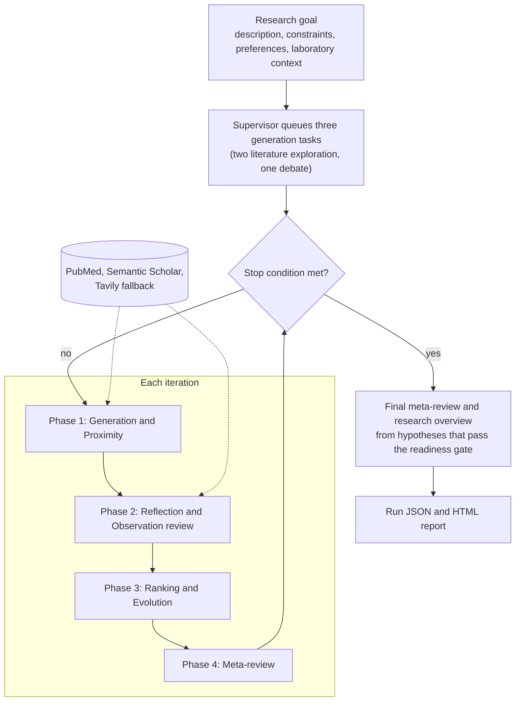

# AGF Co-Scientist

AGF Co-Scientist takes a research goal written in plain language and returns a ranked set of hypotheses, each with a mechanism, an experimental protocol, literature citations and the reviews it passed or failed. It is an independent implementation of the multi-agent design in "Towards an AI co-scientist" by Gottweis et al. at Google ([arXiv:2502.18864](https://arxiv.org/abs/2502.18864), 2025), written for the Australian Genome Foundry (AGF) at Macquarie University. It is not Google's code and is not affiliated with Google.

**Status.** This repository tracks the application deployed at the AGF as of November 2026, where it runs behind the facility's website. The deployment infrastructure stays private: the cloud worker (`scripts/aws_entrypoint.py`), its CloudFormation stack and the website are not included, and the tests that need them skip.

## How a run works

The supervisor (`src/agents/supervisor.py`) runs the loop below itself, not as a LangGraph graph, with the tasks of each phase running concurrently. A run stops on the budget, a 6-hour limit, repeated LLM failure or the iteration limit (default 20), or, after a minimum number of iterations, on Elo convergence or review quality. The final overview uses only hypotheses that pass the readiness gate, which ignores Elo. [docs/architecture.md](docs/architecture.md) has the details and the differences from the paper.



## Limitations and security

- Hypotheses are LLM output. Elo ranks pairwise preference, not correctness, and a hypothesis marked ready has passed automated checks, not experiments. A verified citation is a DOI that resolves to a paper with a matching title; only the full-review LLM judges whether the paper supports the claim, from its title, DOI and stated relevance. The repository includes no benchmark or study of hypothesis quality.
- The safety screen for dual-use and biosafety risk is off by default (`SAFETY_THRESHOLD=0.0`). Switched on, it reviews each new and evolved hypothesis, but keeps one whose safety call fails or returns an unreadable reply, and it never screens the research goal.
- The API has no authentication, and CORS allows any origin with credentials, so any web page open in the same browser can call a running server. Run it on your own machine only.
- The web interface sends API keys and its provider choice as request headers, which the API writes into the process-wide environment only while it handles that request; agents a run creates later use the server's own settings, so set keys and `LLM_PROVIDER` in `03_architecture/.env`. The interface keeps keys in localStorage, offers only Gemini and OpenAI, and its per-agent model choices are not applied.
- Spend is saved to `data/cost_tracking.json` and reloaded, stored budget included, by the next run from the same directory; delete the file to reset it. Prices are fixed in code and convert from USD at 1.55.
- Run state lives in memory (`AsyncStorageAdapter`): the batch runner saves it to `data/runs/`, but API results are lost when the server stops. Neither entry point uses the PostgreSQL and Redis back ends in `src/storage/`.
- Bedrock needs your own AWS account with model access; the default Claude models run through Australian (`au.`) inference profiles.
- The API stores scientist feedback and uploaded PDFs, but no agent reads either, and the interface has no upload page.
- Every tournament match is a multi-turn debate, whereas the paper debates only top-ranked hypotheses. There are no tools for specialised models such as AlphaFold.

## What is implemented

| Agent | Role | Source |
|---|---|---|
| Generation | The paper's four methods: literature exploration, simulated debate, iterative assumptions, research expansion; rejects near-duplicates | `src/agents/generation.py` |
| Reflection | Initial, full, deep-verification and simulation reviews; most search for contradicting papers first | `src/agents/reflection.py` |
| Observation review | Checks a hypothesis against observations from retrieved abstracts | `src/agents/observation_review.py` |
| Ranking | Pairwise matches: debate, decision, Elo update | `src/agents/ranking.py`, `src/tournament/elo.py` |
| Evolution | Refines a top-rated hypothesis into a new one, with seven strategies | `src/agents/evolution.py` |
| Proximity | LLM-scored similarity graph for tournament pairing | `src/agents/proximity.py` |
| Meta-review | Feedback for later prompts, and the research overview | `src/agents/meta_review.py` |
| Safety | Optional hypothesis screen, off by default | `src/agents/safety.py` |
| Supervisor | Task queue, agent weights, stop conditions, checkpoints | `src/agents/supervisor.py`, `src/supervisor/` |

- **Tournament:** Elo from 1200 with K = 32; evolved hypotheses start at 1200 rather than inheriting a rating.
- **Readiness gate** (`src/scientific_readiness.py`): passed full and deep-verification reviews, no failed simulation review, cited papers whose DOIs all verified, and a complete observation review.
- **Literature** (`src/tools/`, `src/literature/`): PubMed and Semantic Scholar with citation-graph expansion, Tavily as a fallback; retracted papers are dropped and cited DOIs checked.
- **Cost control** (`04_Scripts/cost_tracker.py`): each LLM call reserves its worst-case cost against an AUD budget (default 50) before it is sent; unpriced models are refused.
- **Providers** (`src/llm/`): Gemini (the default), OpenAI and AWS Bedrock, with per-agent overrides.
- **Interfaces:** a batch runner writing run JSON and an HTML report (`scripts/run_batch.py`, `src/utils/html_report.py`), a FastAPI app (`src/api/`) and a React web interface (`frontend/`).

Elsewhere: prompt templates adapted from the paper's appendix (`02_Prompts/`); schemas, the conda environment and historical design notes (`03_architecture/`); the AGF's batch goals (`config/`); and an earlier LangGraph pipeline used only by two old tests (`src/graphs/`).

## Quick start

You need conda and either a Gemini or OpenAI API key or AWS credentials with Bedrock access. Run the commands from the repository root, against which `03_architecture/.env` and `data/` are resolved.

```bash
git clone https://github.com/SynBioExplorer/AGF_Co-Scientist.git
cd AGF_Co-Scientist
conda env create -f 03_architecture/environment.yml
conda activate coscientist
cp 03_architecture/.env.example 03_architecture/.env
```

In `03_architecture/.env`:

- Keep `GOOGLE_API_KEY`, which `src/config.py` requires for every provider: a real key for Gemini, the placeholder otherwise.
- Set `LLM_PROVIDER=openai` or `LLM_PROVIDER=bedrock` unless you use Gemini; Bedrock reads the standard AWS credential chain.
- Delete placeholder lines for keys you lack, set `LANGCHAIN_TRACING_V2=false` without LangSmith, and delete the `GOOGLE_*_MODEL` lines, which pin older models than the `src/config.py` defaults.

Run one goal (three iterations, a 15 AUD cap); the run JSON and the HTML report appear in `data/runs/`:

```bash
python scripts/run_batch.py config/batch_goals_verification.yaml
```

Or start the API and the web interface:

```bash
PYTHONPATH=03_architecture uvicorn src.api.main:app --port 8000
# in a second terminal, from the repository root
conda activate coscientist
cd frontend
npm install
npm run dev
```

The API documentation is at http://localhost:8000/docs, the interface at http://localhost:5173. `PYTHONPATH=03_architecture` is needed on case-sensitive file systems such as Linux: ten modules under `src/` add `03_Architecture`, which does not exist there, to the import path, so `import schemas` fails. It is harmless on macOS; the batch runner adds the folder itself. The batch file format is in [docs/configuration.md](docs/configuration.md).

## Configuration

Settings come from `03_architecture/.env` (template: [`.env.example`](03_architecture/.env.example)) and the environment, with defaults in `src/config.py`; [docs/configuration.md](docs/configuration.md) describes each one. The ones most runs need:

| Variable | Default | Purpose |
|---|---|---|
| `GOOGLE_API_KEY` | none | Required whatever the provider |
| `LLM_PROVIDER` | `google` | `google`, `openai` or `bedrock` |
| `OPENAI_API_KEY` | none | For OpenAI |
| `BUDGET_AUD` | `50.0` | Spend limit in AUD; a batch file's `budget_aud` replaces it unless `data/cost_tracking.json` already stores one |
| `BEDROCK_REGION` | `ap-southeast-2` | Region for Bedrock calls |
| `SAFETY_THRESHOLD` | `0.0` | `0` switches the safety screen off |

## Tests

Run `python -m pytest 05_tests/`. The tests were not re-run for this revision. They need the quick-start `.env`; some call live LLM or literature APIs, which costs money (among them the early `phase1_test.py` to `phase3_test.py`), and some skip without the private deployment files.

## Credit

The design is by Juraj Gottweis, Wei-Hung Weng, Alexander Daryin, Tao Tu and colleagues at Google Cloud AI Research, Google Research and Google DeepMind, with external collaborators: "Towards an AI co-scientist", [arXiv:2502.18864](https://arxiv.org/abs/2502.18864) (2025). Its second version (June 2026) is titled "Accelerating scientific discovery with Co-Scientist". The prompt templates in `02_Prompts/` are adapted from the example prompts in the paper's appendix.

## Licence

MIT License.
