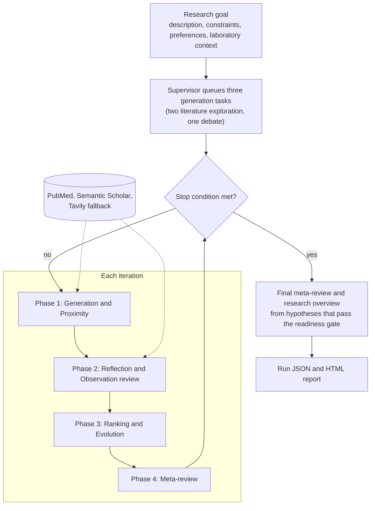

# AGF Co-Scientist

AGF Co-Scientist takes a research goal written in plain language and returns a ranked set of hypotheses, each with a mechanism, an experimental protocol, literature citations and the reviews it passed or failed. It is an independent implementation of the multi-agent design in "Towards an AI co-scientist" by Gottweis et al. at Google ([arXiv:2502.18864](https://arxiv.org/abs/2502.18864), 2025), written for the Australian Genome Foundry (AGF) at Macquarie University. It is not Google's code and is not affiliated with Google.

**Status.** This repository tracks the application deployed at the AGF as of November 2026, where it runs behind the facility's website. The deployment infrastructure stays private: the cloud worker (`scripts/aws_entrypoint.py`), its CloudFormation stack and the website are not in this repository, and the tests that need them skip.

## How a run works



- The supervisor (`src/agents/supervisor.py`) runs the iteration loop itself as asyncio tasks, not as a LangGraph graph. Tasks within a phase run concurrently, at most `MAX_WORKERS` (default 4) at a time. Each phase takes tasks per agent in proportion to the agent's weight, out of twelve slots per iteration, and the supervisor recomputes the weights from run statistics before every iteration (`src/supervisor/statistics.py`).
- The loop ends when the budget is spent, the run reaches its time limit (6 hours), no LLM call succeeds for three iterations in a row (transient failures are waited out for at least 10 minutes), or the iteration limit (default 20) is reached. Elo convergence (0.9) or mean review quality (0.85) can also end it, but only after max(5, 0.7 × iteration limit) iterations, with at least six hypotheses, and once every hypothesis has played a match.
- After 85% of the time limit only tournament matches are scheduled, so late hypotheses still get ranked.
- The final overview considers only hypotheses that pass the readiness gate described below. Elo is not part of the gate.

Reference detail on scheduling, reviews, the tournament and cost control, and a list of where this implementation differs from the paper, is in [docs/architecture.md](docs/architecture.md).

## Limitations and security

- Hypotheses are LLM output. Elo measures pairwise preference between model-written ideas, not correctness, and a hypothesis marked ready has passed automated checks, not experiments. A verified citation is a DOI that resolves to a paper with a matching title. Whether the paper supports the claim is judged only by the full-review LLM, from the title, the DOI and the stated relevance, not from the paper itself. The repository includes no benchmark or study of hypothesis quality. Everything needs expert review.
- The safety screen for dual-use and biosafety risk is off by default (`SAFETY_THRESHOLD=0.0`). Switched on, it reviews each new and evolved hypothesis, but a hypothesis whose safety call fails or returns an unreadable reply is kept unscreened, and the research goal itself is never screened.
- The API has no authentication. CORS allows any origin with credentials, so any web page open in the same browser can call a running server. API keys sent as request headers are written into the process-wide environment for the duration of the request. Run it on your own machine only.
- The web interface keeps API keys in the browser's localStorage and sends them, with its provider choice, as request headers. These apply only while the API handles that request, and a run's agents can be created after it, so set keys and `LLM_PROVIDER` in `03_architecture/.env`. Its per-agent model choices are accepted by the API but not applied, and it offers only Gemini and OpenAI; use the environment variables for Bedrock and per-agent models.
- Spend is saved to `data/cost_tracking.json` and reloaded by the next run started from the same directory, stored budget included. Delete that file to start a fresh budget. Prices in `04_Scripts/cost_tracker.py` are fixed in code and convert from USD at a fixed 1.55.
- Bedrock needs your own AWS account with access to the chosen models, and the default Claude models are invoked through Australian (`au.`) inference profiles.
- Storage is in memory: both entry points use `AsyncStorageAdapter`, so API results are lost when the server stops. PostgreSQL and Redis back ends exist in `src/storage/`, but neither entry point uses them and they were not tested for this revision.
- Scientist feedback sent through the API is stored but no agent reads it. The document upload endpoints (`src/api/documents.py`) store PDFs, but no agent reads them and the web interface has no upload page.
- Every match is a multi-turn debate, whereas the paper debates only top-ranked hypotheses and compares the rest in a single turn. There are no specialised-model tools such as AlphaFold.
- `src/graphs/workflow.py` is an earlier LangGraph pipeline kept for the phase 2 and 3 tests; the supervisor does not use it.

## What is implemented

| Agent | What it does | Source |
|---|---|---|
| Generation | Four methods from the paper: literature exploration, simulated expert debate, iterative assumptions, and research expansion from the current overview. A new hypothesis that an LLM similarity check scores at 0.8 or more against one of the five highest-rated is rejected. | `src/agents/generation.py` |
| Reflection | Initial, full, deep-verification and simulation reviews. Reviews other than deep verification first search for contradicting papers. | `src/agents/reflection.py` |
| Observation review | Tests whether a hypothesis explains observations drawn from the abstracts of retrieved papers. | `src/agents/observation_review.py` |
| Ranking | Pairwise tournament match: a three-turn debate, a decision prompt that sees the transcript, then an Elo update. | `src/agents/ranking.py`, `src/tournament/elo.py` |
| Evolution | Refines one of the five highest-rated hypotheses with one of seven strategies. The result is a new hypothesis with its own reviews. | `src/agents/evolution.py` |
| Proximity | LLM-scored similarity graph and clusters, used for tournament pairing. | `src/agents/proximity.py` |
| Meta-review | Recurring strengths and weaknesses, fed into later prompts, and the research overview. | `src/agents/meta_review.py` |
| Safety | Optional screen of each new and evolved hypothesis. Off by default. | `src/agents/safety.py` |
| Supervisor | Task queue, agent weights, stop conditions and checkpoints. | `src/agents/supervisor.py`, `src/supervisor/` |

**Tournament.** Elo starts at 1200 with K = 32; the API accepts both the K-factor and the number of debate turns per run. Evolved hypotheses start at 1200 and do not inherit their parent's rating. Once a proximity graph exists, pairing gives up to 30% of matches to hypotheses that have not played yet and mixes within-cluster, cross-cluster and top-ranked pairs for the rest.

**Reviews and the readiness gate.** Every new hypothesis gets an initial review. A pass queues a full review, and a passed full review queues deep verification; the three highest-rated hypotheses with a passed full review also get a simulation review. `src/scientific_readiness.py` marks a hypothesis ready only if its latest full and deep-verification reviews passed, no simulation review failed, it cites at least one paper and every citation's DOI was verified, and its observation review is complete. When nothing is ready, the overview says so instead of recommending a hypothesis.

**Literature.** PubMed E-utilities and Semantic Scholar search, citation-graph expansion through Semantic Scholar, and Tavily web search as a fallback (`src/tools/`, `src/literature/`). Papers are scored on citations, recency and journal, and retracted papers are dropped. A cited DOI counts as verified only when the paper it resolves to has a matching title. An evolved hypothesis can cite only papers its parent already cites.

**Cost and budget.** Each LLM call reserves its worst-case cost, at the prices in `04_Scripts/cost_tracker.py`, against an AUD budget (default 50 AUD) before it is sent, and a model without a configured price is refused. The loop keeps 5% of the budget for the final meta-review, overview and report.

**LLM providers.** Google Gemini (the default), OpenAI and AWS Bedrock (`src/llm/`). Bedrock calls go through the Converse API with the standard AWS credential chain; by default Claude Opus 4.8 serves generation, evolution and meta-review and Claude Sonnet 5 the other agents. Each of the six main agents can be given its own provider and model through environment variables.

**API.** A FastAPI app (`src/api/main.py`) to submit a goal with per-run options, poll its status, list and inspect hypotheses with their reviews and match records, send feedback, and chat about a goal. Runs execute as background tasks inside the server process.

**Frontend.** React, TypeScript and Vite (`frontend/`): a dashboard with Elo and quality charts, a hypothesis list with detail views, a chat page and a settings page.

**HTML report.** `scripts/run_batch.py` writes each run to `data/runs/` as JSON plus an HTML report (`src/utils/html_report.py`) with an Elo chart, hypothesis cards that can be filtered and sorted, each hypothesis's readiness and the checks it still needs. The logo is embedded, but Plotly and the fonts load from CDNs, so the chart needs a network connection.

## Quick start

Requirements: conda, and either an API key for Gemini or OpenAI or AWS credentials with Bedrock model access. Run the commands from the repository root: `03_architecture/.env` and the spend record in `data/` are looked up relative to the working directory.

```bash
git clone https://github.com/SynBioExplorer/AGF_Co-Scientist.git
cd AGF_Co-Scientist
conda env create -f 03_architecture/environment.yml
conda activate coscientist
cp 03_architecture/.env.example 03_architecture/.env
```

Edit `03_architecture/.env` before the first run:

- Keep a `GOOGLE_API_KEY` line: `src/config.py` refuses to load without one, whichever provider you use. With Gemini it must be a real key; with OpenAI or Bedrock the placeholder is enough.
- Set `LLM_PROVIDER=openai` or `LLM_PROVIDER=bedrock` unless you use Gemini. Bedrock takes credentials from the standard AWS chain.
- Delete the placeholder lines for the other keys you do not have.
- Set `LANGCHAIN_TRACING_V2=false` unless you have a LangSmith key.
- The example pins older Gemini models; delete the `GOOGLE_*_MODEL` lines to use the defaults in `src/config.py`. The `OPENAI_*_MODEL` lines match the defaults.

Run one goal from the command line (three iterations, a 15 AUD cap):

```bash
python scripts/run_batch.py config/batch_goals_verification.yaml
```

The run JSON and the HTML report appear in `data/runs/`. To run your own goals, copy that YAML file and edit it; the format is in [docs/configuration.md](docs/configuration.md).

Or start the API and the web interface:

```bash
uvicorn src.api.main:app --port 8000
# in a second terminal, from the repository root
conda activate coscientist
cd frontend
npm install
npm run dev
```

The API documentation is at http://localhost:8000/docs and the interface at http://localhost:5173.

## Configuration

Settings are read from `03_architecture/.env` and the environment; [`03_architecture/.env.example`](03_architecture/.env.example) lists them and `src/config.py` holds the defaults. The ones most runs need:

| Variable | Default | Purpose |
|---|---|---|
| `GOOGLE_API_KEY` | none | Required for every provider (see above) |
| `LLM_PROVIDER` | `google` | `google`, `openai` or `bedrock` |
| `OPENAI_API_KEY` | none | For `LLM_PROVIDER=openai` |
| `BUDGET_AUD` | `50.0` | Spend limit in AUD; a batch file's `budget_aud` replaces it unless `data/cost_tracking.json` already stores a budget |
| `TAVILY_API_KEY` | none | Web search fallback for literature retrieval |
| `BEDROCK_REGION` | `ap-southeast-2` | Region for Bedrock calls |
| `SAFETY_THRESHOLD` | `0.0` | `0` switches the safety screen off |

Per-agent overrides, Bedrock inference profiles, literature keys, storage back ends and run options are described in [docs/configuration.md](docs/configuration.md).

## Tests

```bash
python -m pytest 05_tests/
```

The tests were not re-run for this revision. They need the `.env` from the quick start. Some call live LLM or literature APIs, which costs money (the `phase1_test.py` to `phase3_test.py` integration tests from early development among them), and some skip without files from the private deployment.

## Repository layout

| Path | Contents |
|---|---|
| `src/agents/` | The nine agents |
| `src/supervisor/`, `src/tournament/` | Task queue, statistics, checkpoints, Elo and match pairing |
| `src/llm/` | Gemini, OpenAI and Bedrock clients with retries and budget checks |
| `src/tools/`, `src/literature/` | PubMed, Semantic Scholar, refutation search, citation graph, paper scoring |
| `src/api/` | FastAPI app |
| `src/storage/` | In-memory, PostgreSQL and Redis storage |
| `src/utils/html_report.py` | HTML report |
| `02_Prompts/` | Prompt templates adapted from the paper's appendix |
| `03_architecture/` | Pydantic schemas, conda environment, `.env.example`, and design notes written phase by phase during development, which describe earlier states of the code |
| `04_Scripts/cost_tracker.py` | Prices, budget reservation and spend tracking |
| `scripts/run_batch.py` | Command-line batch runner |
| `config/` | Batch goal files used at the AGF |
| `frontend/` | Web interface |
| `05_tests/` | Tests |

## Credit

The design follows Juraj Gottweis, Wei-Hung Weng, Alexander Daryin, Tao Tu and colleagues at Google Cloud AI Research, Google Research and Google DeepMind, with collaborators at Houston Methodist, Sequome, the Fleming Initiative and Imperial College London, and Stanford University School of Medicine: "Towards an AI co-scientist", [arXiv:2502.18864](https://arxiv.org/abs/2502.18864) (2025). The second arXiv version (June 2026) carries the title "Accelerating scientific discovery with Co-Scientist". The prompt templates in `02_Prompts/` are adapted from the example prompts in the paper's appendix.

Literature data comes from PubMed (NCBI E-utilities), Semantic Scholar and Tavily.

## Licence

MIT License.
